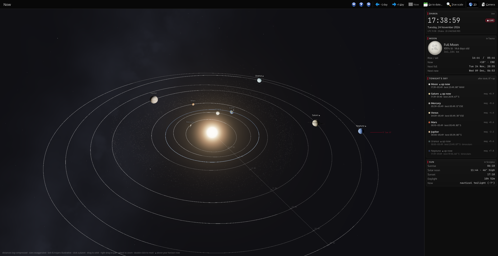
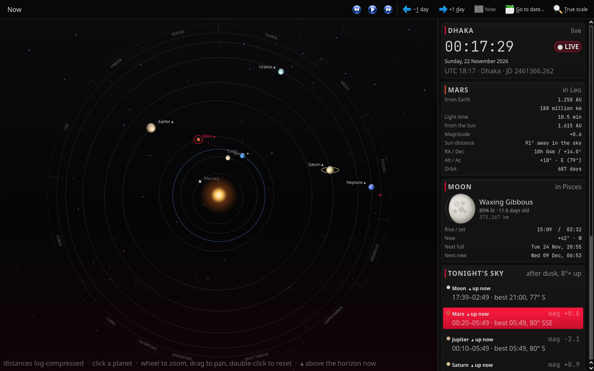

# Orrery

A desk orrery for KDE Plasma. It shows the solar system as it is right now,
the Moon's phase and the Sun's day, and a list of what's worth looking up at
tonight from your city. You can run the clock forwards or backwards
at up to a year per second, or jump to any date from 1800 to 2050.



The solar system is drawn in **3D** with [three.js](https://threejs.org), with
the original flat map one keypress away (V):



It's Python + PySide6 + Kirigami, so it picks up your Plasma colours and icons.
The ephemeris is written from scratch with no astronomy libraries:

- **Planets:** JPL's Keplerian elements (Standish, Table 1, valid 1800–2050),
  with one light-time iteration and precession to the equinox of date.
- **Moon:** the largest terms of Meeus' *Astronomical Algorithms* ch. 47, plus topocentric
  parallax when working out altitudes.
- **Rise/set, transits, phases:** sampling followed by bisection or golden-section refinement.

Checked against JPL DE421 (via skyfield), 1900–2045:

| | worst error |
|---|---|
| Sun, Moon, Mercury, Venus, Mars | ≤ 1.5′ |
| Uranus, Neptune | ≤ 2.3′ |
| Jupiter, Saturn | ≤ 9.6′ (what Table 1 promises) |
| Sun/Moon/planet rise & set (Dhaka) | ≤ 8 s |
| New/full/quarter moon times | ≤ 2.1 min |

## Use

```
./install.sh        # ~/.local/bin/orrery + menu entry, no root
orrery
```

| Key | Action |
|---|---|
| Space | play / pause (starts at 1 day/s) |
| `[` / `]` | slower or reverse / faster |
| ← / → | −1 / +1 day |
| N | back to now (live) |
| Ctrl+G | go to date |
| T | true scale ↔ log-compressed |
| V | 3D view ↔ flat map |
| 1 / 2 / 3 / 4 | camera: overview / top down / edge on / from Earth |

On the map, click a planet to get its distance, light time, magnitude, constellation,
and where it sits in your sky. The mouse wheel zooms, dragging pans, and a
double-click resets the view. The outer ring shows the zodiac constellations
(all 13, Ophiuchus included) laid out by ecliptic longitude.

## The 3D view

Python works out every position, and three.js only draws them: each clock tick
sends the page a small JSON snapshot. Clicks come back over a Qt WebChannel.
What's in it:

- **Orbits** in their real 3D tilt (Mercury's is 7°). Thin drop lines
  run from each planet to the ecliptic, and the stretch of each orbit below the
  plane is drawn dimmer.
- **Spin axes and rotation** from the IAU WGCCRE models (Archinal et al. 2018;
  Mars uses the 2009 secular model). Earth turns on its real 23.44° tilt with a pin
  on your city, Uranus rolls on its side, and Saturn's rings sit in its equator,
  so they open and close over its 29-year orbit (edge-on to us in March 2025).
  Saturn's rings and globe shadow each other. Jupiter and Saturn are flattened
  at the poles by their real amounts.
- **The Moon** points in its true direction from Earth (at a made-up distance)
  and is lit the way Earth sees it, so the phase you see is the real one.
- **The sky behind**: about 100 of the brightest real stars (Yale Bright Star
  Catalogue positions and colours), so Orion and the Plough are where they belong.
  The Milky Way sits on the real galactic plane, and the 13 zodiac constellations
  run along the ecliptic.
- **From Earth** (4): the camera stands on Earth and uses true-scale distances,
  so every planet appears in the right direction against the stars (late 2026:
  Mars and Jupiter side by side in Leo). Drag to look around and use the wheel to zoom.
- **Asteroid belt and Jupiter's trojans**: 9,400 synthetic particles on real
  Keplerian orbits. They show the Kirkwood gaps at the 3:1, 5:2 and 7:3
  resonances and the two trojan swarms 60° ahead of and behind Jupiter.
  Illustrative, not real asteroids.

Sizes are exaggerated everywhere (to scale, Jupiter would be a speck), and the
legend says so. The planet surfaces are procedural shaders, apart from Earth's
coastlines, which come from Natural Earth (public domain).

Click a planet to fly to it and follow it, and click empty space to go back.
Drag orbits the camera, right-drag pans, the wheel zooms, and a double-click
resets the view.

The 3D view needs Qt WebEngine (`qt6-webengine` on Arch). Without it, or with
`ORRERY_NO_3D=1`, the app runs with the flat map only.

**Tonight's sky** covers the stretch from dusk to dawn (Sun below −6°). It lists
when each planet is more than 8° up, plus its best time and direction. Anything
fainter than magnitude 5 is marked "binoculars", which is realistic for a city sky.

## Location

The default is Dhaka. To change it, write `~/.config/orrery/config.json`:

```json
{"name": "Sreemangal", "lat": 24.31, "lon": 91.73, "tz": "Asia/Dhaka"}
```

## Tests

```
python3 -m unittest -v tests.test_astro       # ephemeris + rotation models
cd web && npm test                             # the 3D view's maths
```

The orientation tests check things known independently of the models:
- every planet's axial tilt
- Dhaka facing the Sun at its local noon
- Saturn's 2025 ring-plane crossings: Earth on 23 March, the Sun on 6 May
- the rings' widest opening, in October 2017

## Rebuilding the 3D view

The built bundle (`orrery/web/orrery3d.js`) is checked in, so running the app
doesn't need Node. To change the scene:

```
cd web
npm ci
npm run build      # -> orrery/web/orrery3d.js
```

The source is in `web/src/`: `main.js` (scene), `shaders.js` (GLSL),
`stars.js` (catalogue), and `scale.js` (pure maths, unit-tested).

## Credits

- [three.js](https://threejs.org) (MIT), bundled
- Earth's coastlines: [Natural Earth](https://www.naturalearthdata.com) 1:50m land and lakes (public domain)
- Simplex noise: Ian McEwan and Stefan Gustavson (MIT)

## Licence

GPL-3.0-or-later.
